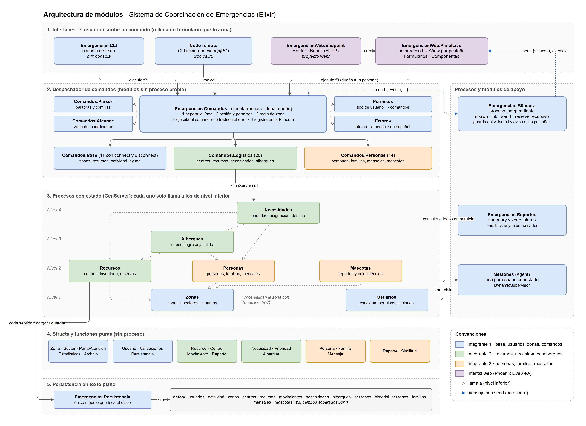
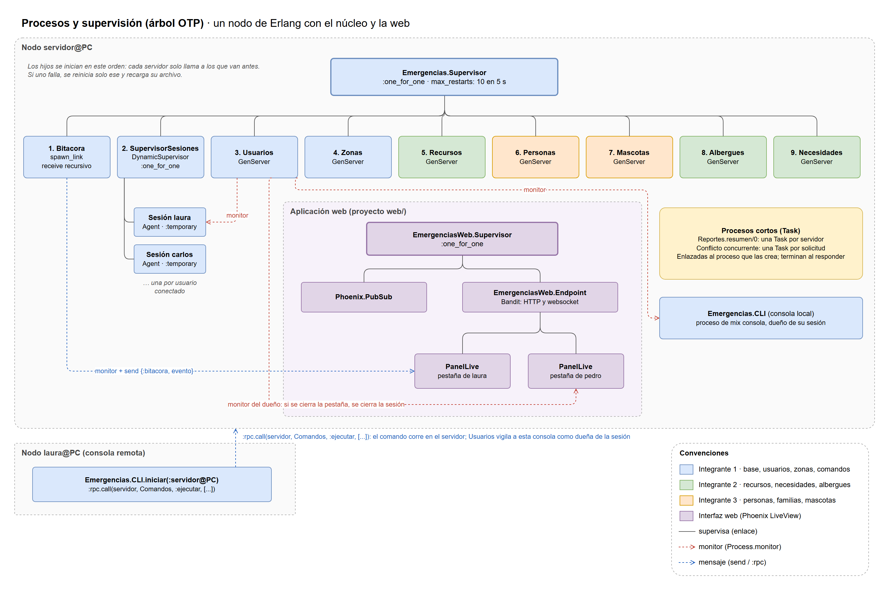
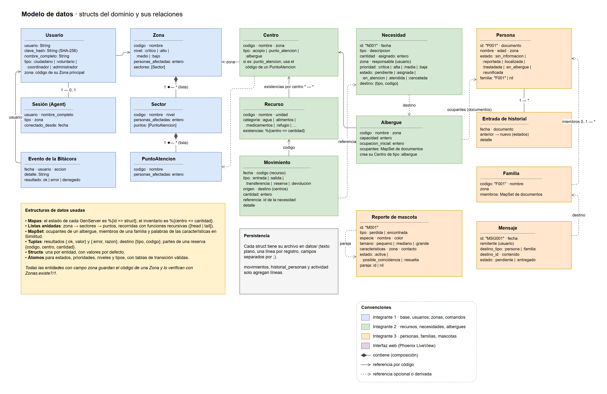
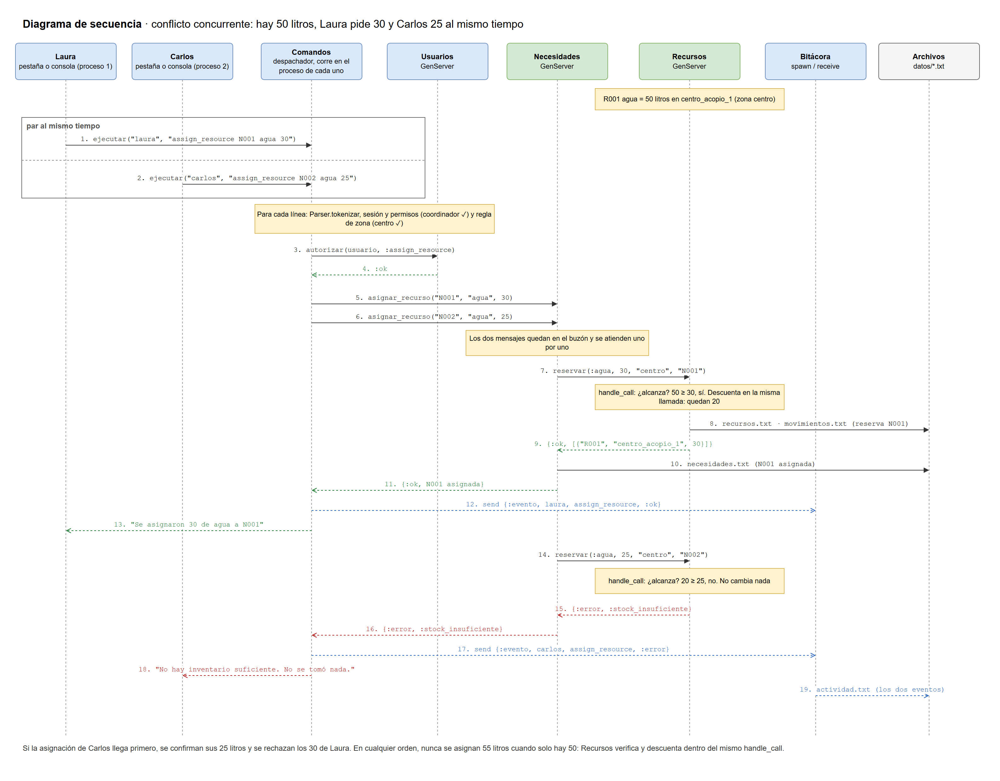
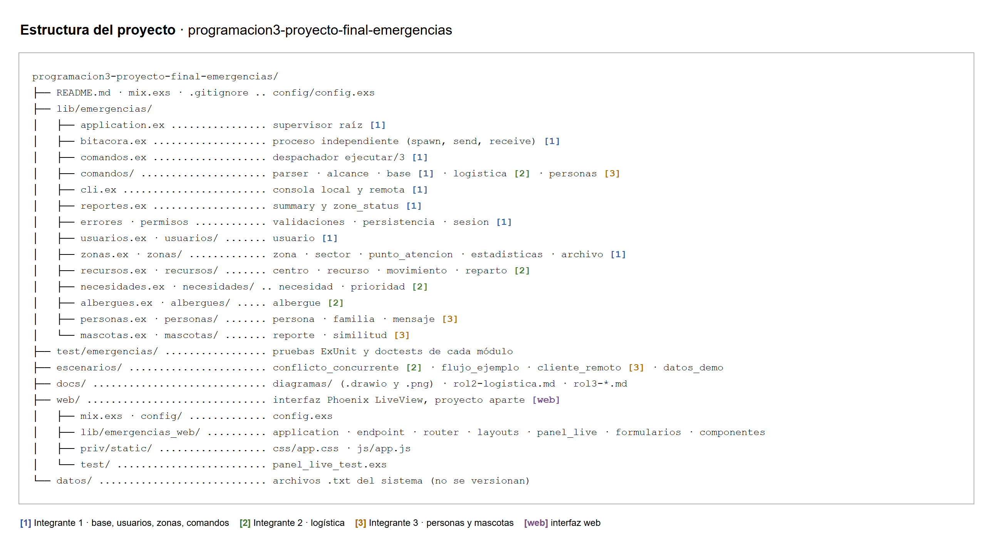

# Sistema Distribuido de Coordinación y Gestión de Emergencias

Proyecto final de **Programación III** · Universidad del Quindío · Ingeniería de Sistemas y Computación

Simulación, en Elixir, de una plataforma multiusuario para coordinar la atención posterior a un terremoto. Varios usuarios registran y consultan zonas afectadas, necesidades, recursos, albergues, personas, mensajes entre familiares y reportes de mascotas, de forma concurrente y sin inconsistencias. Se usa desde una **consola de texto** (local o en otro nodo) o desde una **interfaz web** hecha con Phoenix LiveView; las dos mandan los mismos comandos al mismo despachador.

**Repositorio:** https://github.com/miguelAceballos2112/programacion3-proyecto-final-emergencias

## Integrantes y roles

| Integrante | Rol | Responsabilidad |
|---|---|---|
| Miguel Angel Ceballos Soler | Integrante 1 | Base del sistema: supervisión, persistencia, usuarios, permisos, zonas, despachador, resumen y consola |
| Victor Manuel Bolaños Guzman | Integrante 2 | Logística: recursos, necesidades, albergues y el conflicto concurrente |
| _Juan Ramírez_ | Integrante 3 | Personas, familias, mensajes, mascotas y escenarios de integración |

## Cómo ejecutar

Requisitos: Elixir 1.15 o superior (con Erlang/OTP). El núcleo no tiene dependencias externas; la interfaz web descarga Phoenix con `mix deps.get`.

```
git clone https://github.com/miguelAceballos2112/programacion3-proyecto-final-emergencias.git
cd programacion3-proyecto-final-emergencias
mix test                               # pruebas y doctests del núcleo
mix run escenarios/datos_demo.exs      # (opcional) carga datos de ejemplo en datos/
mix consola                            # consola de texto
```

En la consola se escriben los comandos del enunciado, por ejemplo:

```
emergencias> connect laura 1234 coordinador centro nombre="Laura Gómez"
laura> register_zone centro "Centro" critico 120
laura> register_center centro_acopio_1 "Centro de acopio 1" acopio centro
laura> register_need agua 30 critica centro "Punto de atención sector 3"
laura> register_resource R001 agua 50 litros centro_acopio_1
laura> assign_resource N001 agua 30
laura> summary
laura> salir
```

`help` muestra todos los comandos y `help comando` explica uno. Si el usuario no existe, `connect` lo registra; si existe, valida la contraseña.

### Interfaz web (Phoenix LiveView)

```
cd web
mix setup          # la primera vez: descarga Phoenix
mix phx.server
```

Se abre http://localhost:4000. Hay botones de entrada rápida (Laura y Carlos coordinadores, Marta voluntaria, Pedro ciudadano, admin). Para ver la concurrencia, abra varias pestañas con usuarios distintos: cada pestaña es un proceso del servidor y todas se actualizan al instante cuando otra (o la consola) cambia algo.

La web tiene una sección por tema (resumen, consola, zonas, recursos, necesidades, albergues, personas y mensajes, mascotas, conflicto concurrente, actividad). Cada formulario arma la línea de comando que se escribiría en la consola, la muestra y la manda al despachador, así que los permisos, validaciones y mensajes de error son exactamente los mismos. La sección **Conflicto concurrente** lanza N asignaciones simultáneas sobre el mismo recurso (una `Task` por solicitud) y muestra cuántas se confirmaron y cuántas se rechazaron.

La web y la consola guardan en la misma carpeta `datos/`. No abra la consola local y la web al mismo tiempo (serían dos sistemas escribiendo los mismos archivos): para usar las dos a la vez, use la consola remota contra el nodo de la web (ver abajo) o abra la consola dentro del mismo nodo con `iex -S mix phx.server` y luego `Emergencias.CLI.iniciar()`.

### Dos nodos (consola remota)

```
# Terminal 1: el servidor (núcleo, y opcionalmente la web)
elixir --sname servidor --cookie emergencias -S mix run --no-halt
#   o, con la web:  cd web && elixir --sname servidor --cookie emergencias -S mix phx.server

# Terminal 2: una consola en otro nodo (desde la raíz del proyecto)
elixir --sname laura --cookie emergencias -S mix run --no-start -e "Emergencias.CLI.iniciar(:\"servidor@NOMBRE_DEL_PC\")"
```

`NOMBRE_DEL_PC` es el que muestra el comando `hostname` (las comillas del átomo hacen falta si tiene guiones, por ejemplo `:"servidor@LAPTOP-VK75P3DE"`). Cada comando viaja con `:rpc.call/5` y lo ejecuta el servidor. El escenario `escenarios/cliente_remoto.exs` muestra dos nodos pidiendo agua a la vez (instrucciones al inicio del archivo).

## Arquitectura



- **Interfaces** (consola, nodo remoto, web): solo escriben líneas de comando.
- **Despachador** `Emergencias.Comandos.ejecutar(usuario, linea, dueño)`: separa la línea (`Parser`), verifica la sesión y el tipo de usuario (`Usuarios.autorizar/2` y `Permisos`), aplica la regla de zona del coordinador (`Alcance`), ejecuta el comando (`Comandos.Base`, `Comandos.Logistica` o `Comandos.Personas`), traduce el error a español (`Errores`) y registra la acción en la `Bitacora`. El tipo y la zona del usuario se leen de su sesión en el servidor, nunca de lo que envía el cliente.
- **GenServers** por nivel: cada uno solo llama a los de nivel inferior, así nunca se quedan esperándose entre sí.
- **Persistencia**: un solo módulo toca el disco.

Las fuentes editables de todos los diagramas están en `docs/diagramas/*.drawio` (se abren con draw.io o en https://app.diagrams.net); los `.png` son su exportación.

### Procesos y supervisión



```
Emergencias.Supervisor (:one_for_one, max_restarts 10 en 5 s)
├── Emergencias.Bitacora        proceso independiente: spawn_link, send, receive recursivo
├── Emergencias.SupervisorSesiones (DynamicSupervisor) -> una Sesion (Agent, :temporary) por usuario
├── Emergencias.Usuarios        (GenServer)  vigila con monitor cada sesión y a su dueño
├── Emergencias.Zonas           (GenServer)
├── Emergencias.Recursos        (GenServer)
├── Emergencias.Personas        (GenServer)  personas, familias y mensajes
├── Emergencias.Mascotas        (GenServer)
├── Emergencias.Albergues       (GenServer)
└── Emergencias.Necesidades     (GenServer)

EmergenciasWeb.Supervisor (proyecto web/)
├── Phoenix.PubSub
└── EmergenciasWeb.Endpoint -> un proceso PanelLive por pestaña del navegador
```

### Decisiones de diseño

- **Concurrencia sin inconsistencias:** un GenServer atiende un mensaje a la vez. Las operaciones críticas (reservar recursos, ocupar cupos, resolver reportes) verifican y modifican el estado dentro de un mismo `handle_call`, así que dos solicitudes simultáneas nunca se mezclan.
- **Procesos independientes y paso de mensajes:** la Bitácora no es un GenServer: es un proceso creado con `spawn_link` que atiende `receive` en un bucle recursivo. El despachador le envía cada evento con `send` y no espera. La Bitácora escribe `actividad.txt` (es su único escritor) y reenvía el evento a los procesos suscritos: así cada pestaña web se actualiza cuando otro usuario hace algo.
- **Sesiones con dueño:** cada sesión es un `Agent` creado por un `DynamicSupervisor`. `Usuarios` vigila con `Process.monitor` la sesión y el proceso dueño (la consola o la pestaña): si se cierra la pestaña, la sesión se cierra sola.
- **Supervisión:** estrategia `:one_for_one`, porque los servidores arrancan sin depender unos de otros. Si uno falla, el supervisor lo reinicia y recarga su archivo.
- **Consultas en paralelo:** `summary` pregunta a los servidores al mismo tiempo, con una `Task.async` por consulta.
- **Resultados sin excepciones:** las funciones de dominio devuelven `{:ok, valor}` o `{:error, razon}`; el despachador atrapa el `exit` de un servidor que no responde y lo convierte en un error.
- **Phoenix como capa aparte:** la web es otro proyecto Mix (`web/`) que usa el núcleo como dependencia y solo llama al despachador y a los reportes. Los JavaScript de Phoenix y LiveView se sirven desde sus dependencias, sin Node ni esbuild.

## Modelo de datos



## Persistencia

Archivos de texto plano en `datos/` (se crea al ejecutar; no se versiona; se puede cambiar con la variable `EMERGENCIAS_DATOS`). Un registro por línea y campos separados por `;`.

| Archivo | Contenido |
|---|---|
| `usuarios.txt` | Usuarios (la contraseña se guarda cifrada con SHA-256) |
| `actividad.txt` | Actividad de cada usuario con su resultado (`ok`, `error`, `denegado`); la escribe la Bitácora |
| `zonas.txt` | Zonas, sectores y puntos de atención |
| `centros.txt` | Centros de apoyo con su tipo y su zona |
| `recursos.txt`, `movimientos.txt` | Inventario por centro e historial de movimientos (las reservas llevan el id de la necesidad) |
| `necesidades.txt` | Necesidades puntuales con su destino |
| `albergues.txt` | Albergues, ocupación inicial y ocupantes |
| `personas.txt`, `historial_personas.txt` | Personas e historial de estados (solo se agregan líneas) |
| `familias.txt`, `mensajes.txt` | Familias con sus miembros y mensajes a personas o familias |
| `mascotas.txt` | Reportes de mascotas con su estado y su pareja |

## Usuarios y permisos

Tipos: `ciudadano`, `voluntario`, `coordinador` y `administrador`. La tabla está en `Emergencias.Permisos`; `connect` y `help` son públicos.

| Tipo mínimo | Comandos |
|---|---|
| Ciudadano | `disconnect`, `show_activity`, `list_zones`, `zone_status`, `register_need`, `list_needs`, `list_resources`, `check_shelter`, `report_person`, `find_person`, `register_family`, `add_family_member`, `send_family_message`, `list_family_messages`, `report_pet`, `list_pets` |
| Voluntario | `register_resource`, `pending_needs`, `next_need`, `update_need_status`, `register_entry`, `register_exit`, `update_person_status`, `person_history`, `mark_message`, `match_pets`, `reject_match` |
| Coordinador | `register_zone`, `register_sector`, `register_point`, `register_center`, `add_stock`, `remove_stock`, `list_movements`, `transfer_resource`, `assign_resource`, `cancel_need`, `critical_resources`, `register_shelter`, `shelter_report`, `confirm_match`, `summary` |
| Administrador | `list_users` y `show_activity` de otro usuario |

**Regla de zona del coordinador:** un coordinador solo modifica datos de su zona principal; sus consultas son globales. El administrador no tiene límite de zona. Toda orden rechazada queda en la Bitácora como `denegado`.

## Comandos

| Grupo | Comandos | Módulo |
|---|---|---|
| Sesión | `connect usuario contraseña tipo zona [nombre=]`, `disconnect`, `show_activity`, `list_users`, `help` | `Comandos` y `Comandos.Base` (Integrante 1) |
| Zonas y resumen | `register_zone`, `register_sector`, `register_point`, `list_zones`, `zone_status`, `summary` | `Comandos.Base` (Integrante 1) |
| Recursos | `register_center`, `register_resource`, `list_resources`, `add_stock`, `remove_stock`, `transfer_resource`, `list_movements`, `critical_resources` | `Comandos.Logistica` (Integrante 2) |
| Necesidades | `register_need`, `list_needs`, `assign_resource`, `update_need_status`, `cancel_need`, `next_need`, `pending_needs` | `Comandos.Logistica` (Integrante 2) |
| Albergues | `register_shelter`, `check_shelter`, `register_entry`, `register_exit`, `shelter_report` | `Comandos.Logistica` (Integrante 2) |
| Personas y mensajes | `report_person`, `find_person`, `update_person_status`, `person_history`, `register_family`, `add_family_member`, `send_family_message`, `list_family_messages`, `mark_message` | `Comandos.Personas` (Integrante 3) |
| Mascotas | `report_pet`, `list_pets`, `match_pets`, `confirm_match`, `reject_match` | `Comandos.Personas` (Integrante 3) |

La sintaxis completa sale con `help`. Los detalles de cada parte están en `docs/rol2-logistica.md`, `docs/rol3-personas.md`, `docs/rol3-mascotas.md` y `docs/rol3-comandos.md`.

## Estructuras de datos y recursividad

- **Mapas:** estado de cada servidor (`%{codigo => struct}`), inventario `%{centro => cantidad}`, sesiones y permisos.
- **Listas anidadas:** zona → sectores → puntos de atención.
- **MapSet:** ocupantes de cada albergue, miembros de cada familia y palabras de las características (similitud de mascotas).
- **Tuplas:** resultados `{:ok, valor}` / `{:error, razon}`, destino `{tipo, codigo}`, partes de una reserva `{codigo, centro, cantidad}`.
- **Structs** por entidad y **átomos** para estados, con tablas de transición válidas.

Funciones recursivas propias (con `[head | tail]`, caso base y caso recursivo):

- **Integrante 1:** `Estadisticas.total_sectores/1`, `total_puntos/1`, `contar_puntos/1`, `sectores_por_nivel/2` (con acumulador), `totales_por_sector/1`; `Parser.leer/4` (recorre la línea letra por letra); `Bitacora.bucle/1` (el `receive` del proceso), `avisar/2`, `quitar/2` y `convertir/2`; `CLI.bucle/2`; `Permisos.buscar_accion/2`; `Reportes.contar_por/3` y `sumar_por_categoria/2` (con acumulador); `Comandos.opcion/2`.
- **Integrante 2:** `Reparto.total/1` y `tomar/3`; `Recursos.aplicar_tomas/4`, `aplicar_devoluciones/4` y `punto_en_sectores?/2`; `Recurso.sumar/1`; `Prioridad.ordenar/1` (inserción) y `mas_urgente/1`; `Necesidades.sumar_demanda/2` y `filtrar/2`; `Albergue.ordenar_por_ocupacion/1`; `Validaciones.buscar_opcion/3`; `Comandos.Logistica.opcion/2` y `filtros/1`.
- **Integrante 3:** `Personas.filtrar/2`, `cumple?/2`, `filtrar_historial/2`, `reunir_mensajes/2`, `siguiente_numero/2`; `Similitud.puntaje/3` con `sumar/3`; `Mascotas.filtrar/2`, `elegir_pares/2` y `marcar_pares/2`.

## Validaciones y manejo de errores

- Los identificadores no se repiten (`:ya_existe`); cantidades y capacidades no pueden ser negativas.
- Una reserva que no alcanza no toma nada (`:stock_insuficiente`) y el inventario nunca queda negativo.
- Un albergue no supera su capacidad (`:albergue_lleno`) y una persona no está en dos albergues.
- Los estados siguen transiciones válidas (`:transicion_invalida`); una necesidad atendida o cancelada no recibe recursos (`:necesidad_cerrada`) y un reporte resuelto no se cierra dos veces (`:ya_resuelto`).
- Cada `handle_call` valida antes de modificar: si algo falla, el estado no cambia.
- `Emergencias.Errores` traduce cada razón a un mensaje en español; si faltan datos, el despachador muestra cómo se usa el comando.

## Pruebas

```
mix test               # núcleo: 40 doctests y 283 pruebas
cd web && mix test     # interfaz web: 8 pruebas con Phoenix.LiveViewTest
```

Incluyen casos válidos, inválidos y límite; conexiones, reservas e ingresos simultáneos; el conflicto a través del despachador; permisos y regla de zona; la Bitácora como proceso independiente (y su reinicio); el cierre de sesión cuando muere su dueño; la consola con entrada simulada; la recuperación de un servidor que falla; y, en la web, dos pestañas que se actualizan entre sí. Las pruebas usan una carpeta de datos temporal.

## Escenarios

| Escenario | Qué muestra |
|---|---|
| `mix run escenarios/conflicto_concurrente.exs` | 50 litros: Laura (30) y Pedro (25) a la vez; diez solicitudes de 10; cancelación con devolución |
| `mix run escenarios/flujo_ejemplo.exs` | El flujo completo del enunciado con líneas de comando reales, permisos y el `summary` final |
| `escenarios/cliente_remoto.exs` | Dos nodos cliente contra un nodo servidor con `:rpc.call` |
| `mix run escenarios/datos_demo.exs` | Carga datos de ejemplo para la web y el video |



## Estructura del proyecto



## Lista de verificación del enunciado

| Requisito | Dónde |
|---|---|
| Gestiona usuarios | `usuarios.ex`, `sesion.ex`, `permisos.ex`, `comandos.ex` |
| Gestiona zonas y sectores | `zonas.ex`, `zonas/estadisticas.ex` (recursivo), `zone_status` |
| Gestiona necesidades | `necesidades.ex` (la prioridad ordena y elige) |
| Gestiona recursos | `recursos.ex` (centros, movimientos, transferencias) |
| Comunicación entre familiares | `personas.ex` (personas, familias, mensajes, historial) |
| Mascotas perdidas y encontradas | `mascotas.ex`, `mascotas/similitud.ex` (puntaje) |
| Albergues | `albergues.ex` (cupos, ingreso, salida, reporte de ocupación) |
| Estructuras de datos justificadas | sección anterior |
| Al menos cuatro funciones recursivas propias | más de veinte (sección anterior) |
| Procesos concurrentes | sesiones, Bitácora, GenServers, tareas, pestañas LiveView |
| GenServer | siete servidores |
| Supervisor y DynamicSupervisor | `application.ex` |
| Conflicto concurrente resuelto | `escenarios/conflicto_concurrente.exs`, pruebas y la web |
| Persistencia | `persistencia.ex` y un archivo por componente |
| Pruebas | `test/` y `web/test/` |
| Diagramas que corresponden al código | `docs/diagramas/` |

## Video de demostración

_(enlace)_
