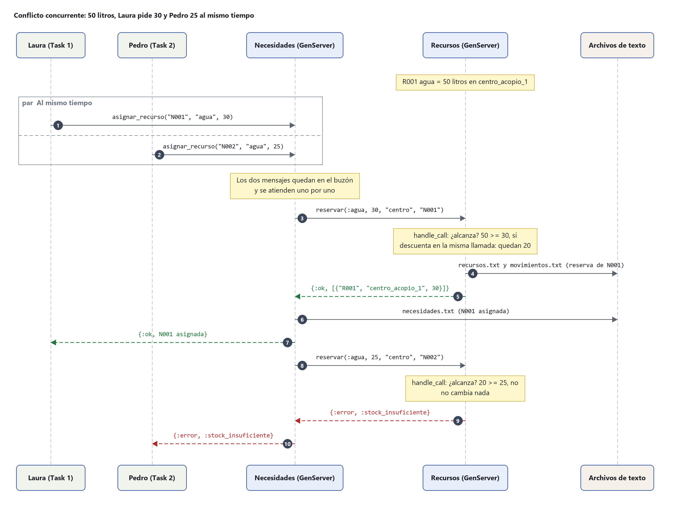
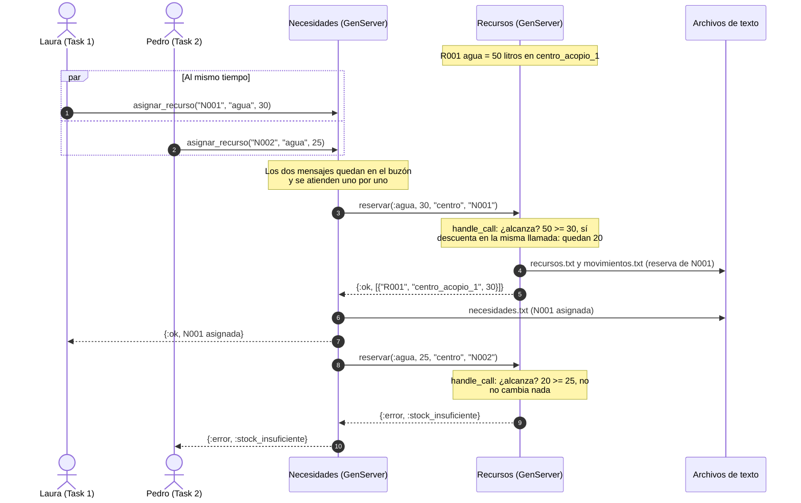

# Diagrama de secuencia: conflicto concurrente sobre el inventario

Laura y Pedro piden agua al mismo tiempo. Hay 50 litros y entre los dos piden 55.

El mismo diagrama en Mermaid (GitHub lo dibuja al abrir este archivo):

Si el mensaje de Pedro llega primero, se confirman sus 25 litros y se rechazan los 30
de Laura. En los dos casos nunca se asignan 55 litros cuando solo hay 50.

Si se cambia el diagrama, el PNG se puede volver a generar copiando el bloque en
<https://mermaid.live> y descargándolo como PNG.
