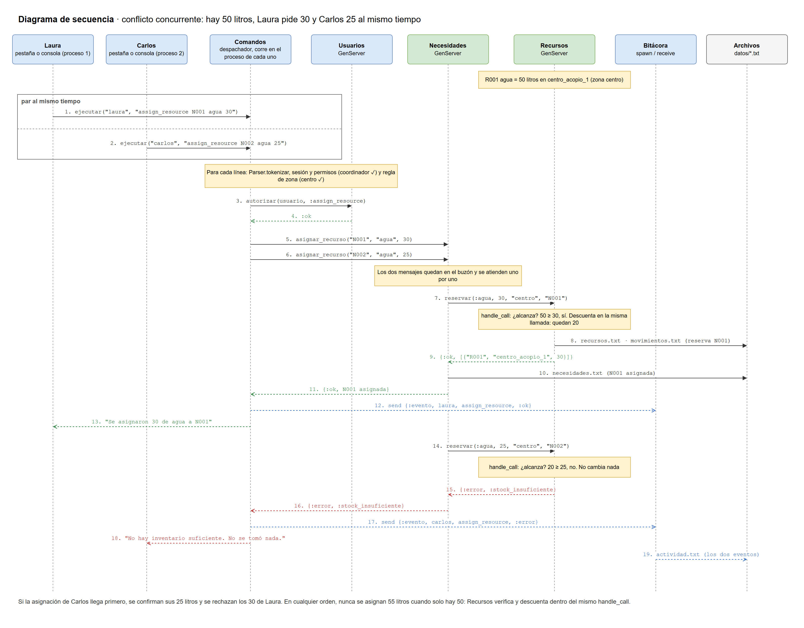
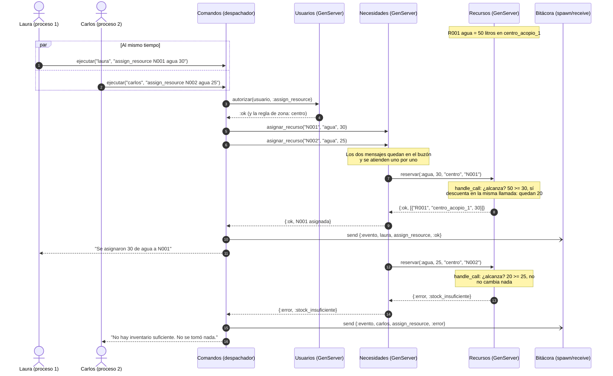

# Diagrama de secuencia: conflicto concurrente sobre el inventario

Laura y Carlos (dos coordinadores de la zona centro) asignan agua al mismo tiempo.
Hay 50 litros y entre los dos piden 55.

La fuente editable es `secuencia_conflicto.drawio` (se abre con draw.io o en
<https://app.diagrams.net>). El mismo flujo en Mermaid, que GitHub dibuja al abrir
este archivo:

Si la asignación de Carlos llega primero, se confirman sus 25 litros y se rechazan los
30 de Laura. En cualquier orden, nunca se asignan 55 litros cuando solo hay 50.

Se reproduce con `mix run escenarios/conflicto_concurrente.exs`, con
`mix run escenarios/flujo_ejemplo.exs` (paso 3) o en la web, sección
**Conflicto concurrente**.
